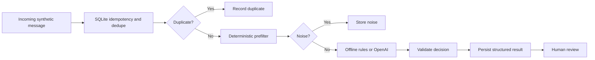

# Architecture and boundaries

## Decisions and trade-offs

- This is an independently built portfolio demo. No code, real rules, source lists, contacts, access tokens or private data were copied from a commercial implementation.
- SQLite is appropriate for a single-user demo, not a production multi-worker queue with migrations and robust locking/leases.
- `source + external_id` protects repeated ingest; normalized text hash catches exact-text reposts but is not semantic deduplication.
- The sample prefilter avoids some model calls. It is illustrative, **not** a measured quality model.
- Default mode is entirely offline. Optional OpenAI mode makes a genuine API request for ambiguous cases after prefiltering.
- All text is untrusted; parsed decisions are validated. Failed provider calls return a held-for-review state.
- `approve` only changes review status. There are **no external writes**, email campaigns or messaging bots.
- No auth, distributed jobs, PII retention policy, provider rate-limit queue, observability pipeline or end-to-end production load tests are included.
- Run only on localhost; never expose these demo endpoints publicly.
- Production evolution: add auth/RBAC, managed secrets, PostgreSQL, migrations, background queue/workers, retries with idempotency keys, audit records, metrics, safe data deletion and labelled evaluation datasets.
